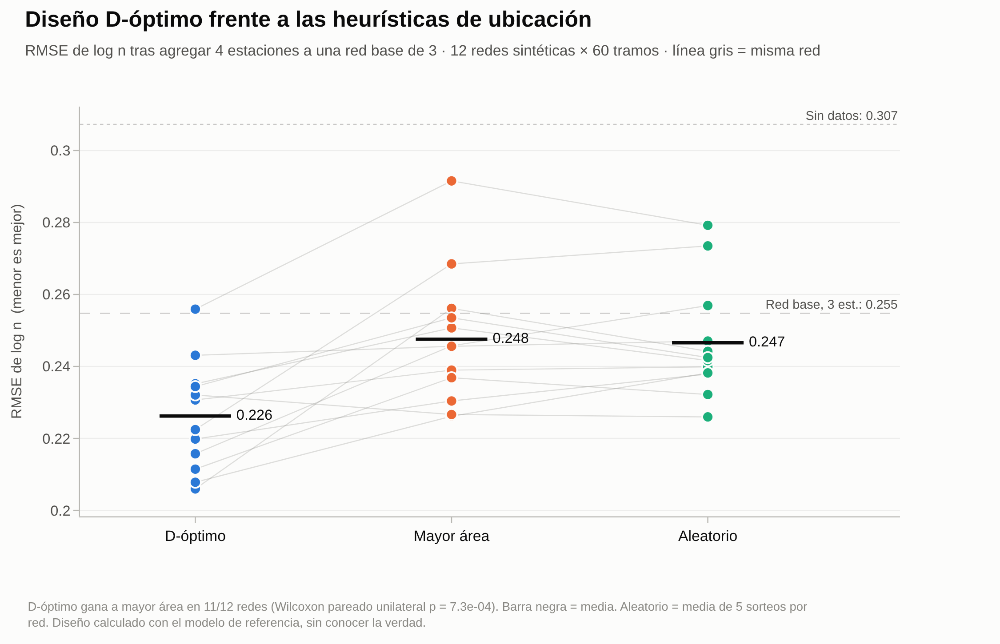
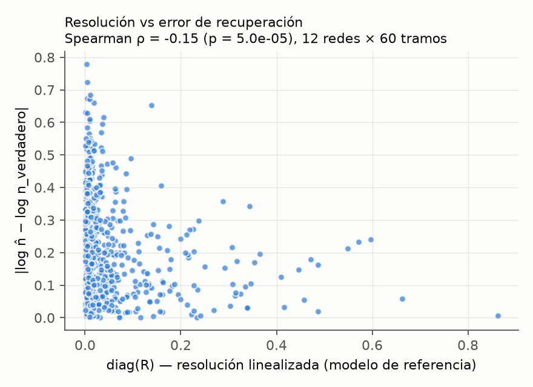

# inversion-ruteo-fluvial-co

<!-- Tras la primera publicación en Zenodo, reemplace XXXXXXX por el DOI de concepto -->
<!--  -->

**¿Qué parte de la red de ríos de Colombia pueden "ver" las estaciones hidrométricas, y dónde
conviene instalar la próxima?**

Este repositorio aplica el flujo de trabajo de la **inversión geofísica** (operador directo,
regularización, matriz de resolución, diseño de adquisición) al **ruteo de caudales** en redes
fluviales, con un operador Muskingum–Cunge diferenciable que **conserva la masa por
construcción**.

---

## Motivación

- **Pocas series útiles.** CAMELS‑COL conservó **347 de 921** estaciones de IDEAM con registros
  aprovechables. La Amazonía y la Orinoquía están poco instrumentadas
  ([Jiménez et al., ESSD preprint](https://essd.copernicus.org/preprints/essd-2025-200/)).
- **El aprendizaje diferenciable ya invierte parámetros de ruteo**
  ([Bindas et al., 2024, *WRR*](https://doi.org/10.1029/2023WR035337)). Pero no se ha medido,
  tramo por tramo, **cuánto de lo aprendido viene de los datos y cuánto de los supuestos**.
- **Instalar una estación cuesta.** Hoy esa decisión se apoya en criterios de entropía, de redes
  complejas o administrativos, no en la información que aporta a un modelo físico.

## Pregunta de investigación

> ¿Qué parte de la red fluvial colombiana pueden "ver" las estaciones actuales cuando se
> invierten parámetros de ruteo con un operador que conserva la masa, y dónde debería
> instalarse la próxima estación para maximizar lo que se aprende de la red?

Cinco hipótesis falsables (H1–H5), con su prueba y su criterio de rechazo, en
[`docs/protocolo.md`](docs/protocolo.md).

## Estado — v0.1.0 (oct. 2026)

| Fase | Contenido | Estado |
|---|---|---|
| 0 | Viabilidad con datos reales (CAMELS‑COL + GRanD) | ✅ Datos: **VIABLE**. Literatura: pendiente |
| 1 | Verificación sintética (E01: H1, H2) | ✅ E01 completo · E02, E03 planeados |
| 2 | Inversión con datos reales, piloto 31097010 | ⏳ No iniciada |
| 3 | Mapa de resolubilidad y ranking de sitios; artículo | ⏳ |

> La revisión de literatura es preliminar ([`docs/estado_del_arte.md`](docs/estado_del_arte.md)):
> ninguna afirmación de novedad es definitiva.

## Enfoque

    aporte lateral q ─► [ Muskingum–Cunge diferenciable G(m) ] ─► caudal diario en estaciones d
                             m = log n (rugosidad de Manning por tramo)

    Inversión:   min  ‖W_d (P·G(m) − d_obs)‖² + β (α_s‖m − m_ref‖² + α_x‖D(m − m_ref)‖²)
    Resolución:  R = (JᵀW_d²J + βW_mᵀW_m)⁻¹ JᵀW_d²J        diag(R) ∈ [0, 1] por tramo
    Diseño:      siguiente estación = argmax_c  log det(H + F_c)         (criterio D)

La correspondencia con cada sesión del curso
[`inversion-geofisica-python`](https://github.com/nvasquezc/inversion-geofisica-python) está en
[`docs/puente_inversion_geofisica.md`](docs/puente_inversion_geofisica.md).

## Resultados

### E01 — sintético, 12 redes × 60 tramos

40 días, paso horario, observaciones como **media diaria** (igual que IDEAM y CAMELS‑COL), error
del 5 % + 0,5 m³/s. Red base de 3 estaciones a la que se agregan 4 con distintas estrategias.

| Configuración | RMSE de log *n* (media de 12 redes) |
|---|---|
| Solo el valor de referencia (sin datos) | 0,307 |
| Red base (3 estaciones) | 0,255 |
| + 4 estaciones aleatorias (5 sorteos por red) | 0,247 |
| + 4 estaciones en los ríos de mayor área | 0,248 |
| **+ 4 estaciones con diseño D‑óptimo** | **0,226** |

- **H2 (diseño) — apoyada.** El diseño D‑óptimo, calculado **sin conocer la verdad**, gana en
  **11 de 12 redes**. Wilcoxon pareado unilateral p = 7×10⁻⁴; diferencia media frente a mayor
  área −0,021 (IC bootstrap 95 % [−0,031; −0,012]), ~8 % menos error.
- **H1 (la resolución predice el error) — apoyo débil.** ρ de Spearman negativa en 12 de 12
  redes, pero pequeña (mediana −0,15).
- **Hallazgo principal: identificabilidad baja.** Con caudal medio diario solo el **13 %** de los
  tramos tiene diag(R) > 0,1 y menos del **1 %** supera 0,5: la mayor parte del campo de
  rugosidad lo fija la regularización. Los mapas de *n* aprendidos sin análisis de resolución
  deben leerse con cautela.

### Fase 0 — CAMELS‑COL v3 + GRanD v1.3

| Resultado | Valor |
|---|---|
| Estaciones con otra estación aguas abajo | 300 de 346 |
| Cuencas independientes con ≥ 3 estaciones anidadas | 18 (21 subsistemas con ≥ 10 años de registro común) |
| Error de área polígono vs. tabla (mediana) | 0,76 % |
| Estaciones con al menos una presa en su cuenca | 36 de 346 |
| Cuencas sin presas (grupo A) | 15, con 89 estaciones |
| Cuenca piloto para la Fase 2 | 31097010 (natural, 11 estaciones, 138 309 km²) |

Tablas en [`results/fase0/`](results/fase0/). Tratamiento de las cuencas reguladas
(Magdalena‑Cauca, 35257040, Sinú) en [`docs/protocolo.md`](docs/protocolo.md).

### Garantía física verificada

`tests/test_nucleo.py` comprueba la continuidad discreta por tramo y en toda la red,
Δt·½Σ[(I_t + I_{t+1}) − (O_t + O_{t+1})] = S_T − S_0, con error relativo < 10⁻¹⁰. La conservación
es una propiedad de la arquitectura, no un término de penalización. También se verifican el
gradiente frente a diferencias finitas, la causalidad del Jacobiano, diag(R) ∈ [0, 1] y la
monotonía del criterio D.

## Reproducir

Requiere [uv](https://docs.astral.sh/uv/). Todo corre en CPU.

    uv sync --all-extras                                    # entorno y dependencias
    uv run ruff check .                                     # estilo
    uv run pytest -q                                        # 16 pruebas
    uv run python experiments/e00_inversion_una_red.py      # una inversión, ~15 s
    uv run python experiments/e01_identificabilidad_sintetica.py --redes 12 --aleatorios 5   # ~5 min

Notebook paso a paso:

    uv run python scripts/construir_notebook.py
    uv run jupyter nbconvert --to notebook --execute --inplace notebooks/01_analisis_paso_a_paso.ipynb

Fase 0 (necesita los datos descritos en [`data/README.md`](data/README.md)):

    uv run python scripts/descargar_camels_col.py            # Zenodo 18794895, verifica MD5
    uv run python scripts/fase0_anidamiento.py               # anidamiento por polígonos de cuenca
    uv run python scripts/resumen_sistemas_fase0.py          # sistemas de estaciones anidadas
    uv run python scripts/marcar_embalses.py --presas data/GRanD_Version_1_3/GRanD_dams_v1_3.shp

## Arquitectura

    datos (CAMELS‑COL, GRanD) ─► datos.py: anidamiento, tramos, embalses
                                        │
    red.py: DAG + orden topológico ─► ruteo.py: Muskingum–Cunge G(m) ─► promedio diario
                                        │ autodiff (PyTorch)
                     ┌──────────────────┼──────────────────────┐
              inversion.py        resolucion.py            resolucion.py
           Tikhonov + β‑cooling   J, R, covarianza      diseño D/A‑óptimo
           inversión neuronal

## Estructura

    src/ruteo_inverso/
      red.py          red fluvial como DAG; orden topológico; regularizador en el grafo
      ruteo.py        operador directo Muskingum–Cunge diferenciable (conserva masa)
      forzamiento.py  aporte lateral y rugosidad "verdadera" sintéticos
      inversion.py    Tikhonov con β‑cooling y discrepancia; inversión neuronal no supervisada
      resolucion.py   Jacobiano (autodiff), matriz de resolución, covarianza, diseño D/A‑óptimo
      datos.py        anidamiento por polígonos y por HydroRIVERS; asignación de estaciones a tramos
      graficos.py     dibujo de la red y estilo de figuras
    tests/            16 pruebas
    experiments/      E00 (una red) y E01 (12 redes); E02 y E03 planeados
    notebooks/        01_analisis_paso_a_paso.ipynb (empieza aquí)
    scripts/          construcción del notebook, descarga de datos y análisis de la Fase 0
    docs/             documentación (índice abajo)
    results/          figuras y JSON de E01; results/fase0/ con anidamiento y embalses
    data/             datos de terceros (no versionados; ver data/README.md)

## Documentación

| # | Documento | Contenido |
|---|---|---|
| 00 | [`notebooks/01_analisis_paso_a_paso.ipynb`](notebooks/01_analisis_paso_a_paso.ipynb) | **Empieza aquí.** 12 pasos ejecutados, de la red como grafo al diseño D‑óptimo |
| 01 | [`docs/protocolo.md`](docs/protocolo.md) | Pregunta, hipótesis H1–H5, fases, decisión de la Fase 0, métricas y amenazas a la validez |
| 02 | [`docs/estado_del_arte.md`](docs/estado_del_arte.md) | Revisión preliminar y protocolo de la revisión sistemática |
| 03 | [`docs/puente_inversion_geofisica.md`](docs/puente_inversion_geofisica.md) | Correspondencia con el curso de inversión geofísica |
| 04 | [`data/README.md`](data/README.md) | Fuentes de datos, licencias y formato verificado de CAMELS‑COL |
| 05 | [`CHANGELOG.md`](CHANGELOG.md) | Historial de versiones |

## Utilidad para Colombia

El producto previsto es (1) un **mapa de resolubilidad** de la red de aforo de IDEAM y (2) un
**ranking cuantitativo de sitios** donde una nueva estación aportaría más información al modelo
de ruteo usado en pronóstico y alerta. Sirve para priorizar inversión en monitoreo hídrico
(IDEAM, CAR, gestión del riesgo) con un criterio reproducible.

## Origen y créditos

- El marco de inversión proviene del curso *Inversión geofísica en Python* (original de
  Anagabrielamantilla et al.; MINCIENCIAS–ANH–UIS). **No se reutiliza su código**, porque el
  curso no declara licencia abierta.
- El proyecto nace de un cuaderno exploratorio de GNN "informadas por la física" sobre la red vial
  de Chapinero, con datos sintéticos y una restricción que no actuaba a escala urbana. De ahí la
  pregunta que este repositorio aborda con un problema físico real: **¿cuándo la física impuesta
  por construcción aporta información que los datos solos no dan?**

## Cómo citar

Use el botón **"Cite this repository"** de GitHub o el archivo [`CITATION.cff`](CITATION.cff):

> Vásquez Castro, N. O. (2026). *inversion-ruteo-fluvial-co: inversión de ruteo fluvial,
> resolución y diseño de redes hidrométricas para Colombia* (v0.1.0) [Software].
> https://github.com/nvasquezc/inversion-ruteo-fluvial-co

Si usa los resultados de la Fase 0, cite también CAMELS‑COL (Zenodo 18794895) y GRanD v1.3.

## Licencias

Código bajo [MIT](LICENSE). Documentación, notebook y resultados bajo
[CC BY 4.0](LICENSE-docs.md). Los datos de terceros conservan sus licencias de origen.

## Autor

**Néstor Oswaldo Vásquez Castro** — Jitter Ingeniería SAS / Universidad Central (Bogotá, Colombia)

