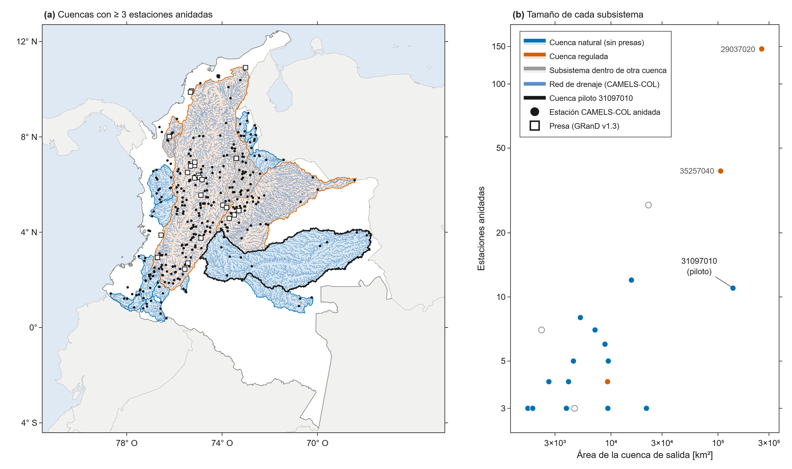
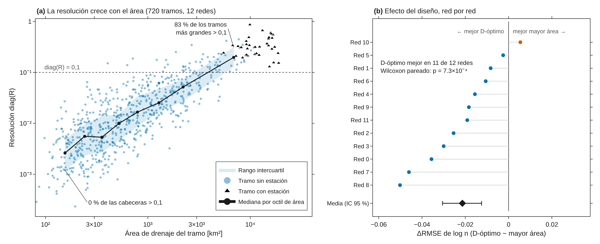

# inversion-ruteo-fluvial-co

**¿Qué parte de la red de ríos de Colombia pueden "ver" las estaciones hidrométricas, y dónde
conviene instalar la próxima?**

Este repositorio aplica el flujo de trabajo de la **inversión geofísica** (operador directo,
regularización, matriz de resolución, diseño de adquisición) al **ruteo de caudales** en redes
fluviales, con un operador Muskingum–Cunge diferenciable que **conserva la masa por
construcción**.

**Figura 1.** Dónde se puede aplicar con datos reales. (a) Cuencas de Colombia con al menos tres
estaciones de CAMELS‑COL anidadas y diez años de registro común: naturales (azul), reguladas por
presas de GRanD v1.3 (bermellón) y subsistemas contenidos en otra cuenca (gris), con la red de
drenaje de CAMELS‑COL, las estaciones anidadas (puntos) y las presas (cuadrados). En negro, la
cuenca piloto 31097010 (río Meta, 138 309 km², 11 estaciones). (b) Estaciones anidadas frente al
área de la cuenca de salida de cada subsistema. Límites: Natural Earth 10 m.
[Versión interactiva](results/fase0/fase0_cuencas_anidadas.html).

---

## Resultados principales

**Figura 2.** Qué se puede aprender del caudal medio diario (experimento E01: 12 redes sintéticas
de 60 tramos, tres estaciones, error del 5 % + 0,5 m³ s⁻¹). (a) Resolución linealizada diag(R) de
cada tramo frente a su área de drenaje, con la mediana y el rango intercuartil por octil de área;
diag(R) = 1 significa que el valor de *n* lo determinan los datos y 0 que lo determina la
regularización. (b) Diferencia de error en log *n* entre ubicar cuatro estaciones nuevas con
diseño D‑óptimo y en los cuatro tramos de mayor área, red por red, con la media y su IC del 95 %
(bootstrap). [Versión interactiva](results/e01_sintesis.html).

| Resultado (sintético, 12 redes) | Valor |
|---|---|
| Parámetros efectivamente resueltos con 3 estaciones, tr(R) | **2,9 de 60** en promedio |
| Tramos con diag(R) > 0,1 | **13 %** en total; 83 % en el octil de mayor área (> 3 200 km²), 3 % en el resto |
| Relación área–resolución | ρ de Spearman = 0,81 entre log área y log diag(R) (720 tramos) |
| RMSE de log *n*: sin datos → red base → + 4 D‑óptimo | 0,307 → 0,255 → **0,226** |
| D‑óptimo frente a mayor área | mejor en **11 de 12** redes; Wilcoxon pareado p = 7×10⁻⁴; ΔRMSE = −0,021 [−0,031; −0,012] |
| Cuencas reales con ≥ 3 estaciones anidadas (Fase 0) | **18** independientes, **15** sin presas |

- **Hallazgo central: identificabilidad baja y dependiente de la escala.** Con caudal medio
  diario, la rugosidad solo se resuelve en los tramos grandes cercanos a las estaciones; en las
  cabeceras la decide la regularización. Un mapa de *n* aprendido sin análisis de resolución puede
  parecer detallado y estar mostrando el supuesto, no los datos. Concuerda con Bindas et al.
  (2024), que solo hallaron beneficio en subcuencas mayores a 2 000 km².
- **H2 (diseño) — apoyada.** El diseño D‑óptimo, calculado **sin conocer la verdad**, reduce el
  error ≈ 8 % más que la heurística de aforar los ríos más grandes, que repite información sobre
  el mismo cauce. El efecto es modesto y se obtuvo con aporte lateral perfecto.
- **H1 (diag(R) predice el error) — apoyo débil.** ρ negativa en 12 de 12 redes, pero pequeña
  (mediana −0,15).
- **Fase 0 — viable.** Los datos reales permiten seguir; la piloto 31097010 se eligió por escala,
  precisamente porque la resolución se concentra en los tramos grandes.

> **Alcance.** Los resultados de identificabilidad y diseño son sintéticos y linealizados; el
> modelo aún no ha invertido datos de IDEAM. La revisión de literatura es preliminar
> ([`docs/estado_del_arte.md`](docs/estado_del_arte.md)): ninguna afirmación de novedad es
> definitiva.

El análisis completo, con 14 figuras numeradas y su interpretación, está en el cuaderno
**[`notebooks/01_analisis_paso_a_paso.ipynb`](notebooks/01_analisis_paso_a_paso.ipynb)**.

## Motivación

- **Pocas series útiles.** CAMELS‑COL conservó **347 de 921** estaciones de IDEAM con registros
  aprovechables. La Amazonía y la Orinoquía están poco instrumentadas
  ([Jiménez et al., ESSD preprint](https://essd.copernicus.org/preprints/essd-2025-200/)).
- **El aprendizaje diferenciable ya invierte parámetros de ruteo**
  ([Bindas et al., 2024, *WRR*](https://doi.org/10.1029/2023WR035337)). Pero no se ha medido,
  tramo por tramo, **cuánto de lo aprendido viene de los datos y cuánto de los supuestos**.
- **Instalar una estación cuesta.** Hoy esa decisión se apoya en criterios de entropía, de redes
  complejas o administrativos, no en la información que aporta a un modelo físico.

## Pregunta de investigación

> ¿Qué parte de la red fluvial colombiana pueden "ver" las estaciones actuales cuando se
> invierten parámetros de ruteo con un operador que conserva la masa, y dónde debería
> instalarse la próxima estación para maximizar lo que se aprende de la red?

Cinco hipótesis falsables (H1–H5), con su prueba y su criterio de rechazo, en
[`docs/protocolo.md`](docs/protocolo.md).

## Estado — v0.1.1 (oct. 2026)

| Fase | Contenido | Estado |
|---|---|---|
| 0 | Viabilidad con datos reales (CAMELS‑COL + GRanD) | ✅ Datos: **viable**. Literatura: pendiente |
| 1 | Verificación sintética (E01: H1, H2) | ✅ E01 completo · E02 (no lineal) y E03 (MCMC) planeados |
| 2 | Inversión con datos reales, piloto 31097010 | ⏳ No iniciada |
| 3 | Mapa de resolubilidad y ranking de sitios; artículo | ⏳ |

## Enfoque

    aporte lateral q ─► [ Muskingum–Cunge diferenciable G(m) ] ─► caudal diario en estaciones d
                             m = log n (rugosidad de Manning por tramo)

    Inversión:   min  ‖W_d (P·G(m) − d_obs)‖² + β (α_s‖m − m_ref‖² + α_x‖D(m − m_ref)‖²)
    Resolución:  R = (JᵀW_d²J + βW_mᵀW_m)⁻¹ JᵀW_d²J        diag(R) ∈ [0, 1] por tramo
    Diseño:      siguiente estación = argmax_c  log det(H + F_c)         (criterio D)

La conservación de masa es una propiedad de la arquitectura (c₀ + c₁ + c₂ = 1), no un término de
penalización: `tests/test_nucleo.py` verifica la continuidad discreta por tramo y en toda la red
con error relativo < 10⁻¹⁰, además del gradiente frente a diferencias finitas, la causalidad del
Jacobiano, diag(R) ∈ [0, 1] y la monotonía del criterio D. La correspondencia con cada sesión del
curso [`inversion-geofisica-python`](https://github.com/nvasquezc/inversion-geofisica-python) está
en [`docs/puente_inversion_geofisica.md`](docs/puente_inversion_geofisica.md).

## Reproducir

Requiere [uv](https://docs.astral.sh/uv/). Todo corre en CPU.

    uv sync --all-extras                                    # entorno y dependencias
    uv run ruff check .                                     # estilo
    uv run pytest -q                                        # 16 pruebas
    uv run python experiments/e00_inversion_una_red.py      # una inversión, ~15 s
    uv run python experiments/e01_identificabilidad_sintetica.py --redes 12 --aleatorios 5   # ~5 min

Figuras (Plotly, HTML interactivo + PNG a ~300 ppp; el PNG necesita Chrome: `uv run plotly_get_chrome`):

    uv run python scripts/preparar_mapa_fase0.py    # capa del mapa (necesita los datos crudos; ya versionada)
    uv run python scripts/figuras_resultados.py     # figuras 1 y 2 de este README

Cuaderno:

    uv run python scripts/construir_notebook.py
    uv run jupyter nbconvert --to notebook --execute --inplace notebooks/01_analisis_paso_a_paso.ipynb

Fase 0 (necesita los datos descritos en [`data/README.md`](data/README.md)):

    uv run python scripts/descargar_camels_col.py            # Zenodo 18794895, verifica MD5
    uv run python scripts/fase0_anidamiento.py               # anidamiento por polígonos de cuenca
    uv run python scripts/resumen_sistemas_fase0.py          # sistemas de estaciones anidadas
    uv run python scripts/marcar_embalses.py --presas data/GRanD_Version_1_3/GRanD_dams_v1_3.shp

## Estructura

    src/ruteo_inverso/
      red.py          red fluvial como DAG; orden topológico; regularizador en el grafo
      ruteo.py        operador directo Muskingum–Cunge diferenciable (conserva masa)
      forzamiento.py  aporte lateral y rugosidad "verdadera" sintéticos
      inversion.py    Tikhonov con β‑cooling y discrepancia; inversión neuronal no supervisada
      resolucion.py   Jacobiano (autodiff), matriz de resolución, covarianza, diseño D/A‑óptimo
      datos.py        anidamiento por polígonos y por HydroRIVERS; asignación de estaciones a tramos
      graficos.py     figuras de publicación (Plotly): red en planta, mapas, E01, Fase 0
      recursos/       límites de países (Natural Earth 10 m, dominio público)
    tests/            16 pruebas
    experiments/      E00 (una red) y E01 (12 redes); E02 y E03 planeados
    notebooks/        01_analisis_paso_a_paso.ipynb (empieza aquí)
    scripts/          cuaderno, figuras, capa del mapa, descarga de datos y Fase 0
    docs/             documentación (índice abajo)
    results/          E01 (JSON, figuras); fase0/ (tablas de anidamiento y embalses, capa del mapa)
    data/             datos de terceros (no versionados; ver data/README.md)

## Documentación

| # | Documento | Contenido |
|---|---|---|
| 00 | [`notebooks/01_analisis_paso_a_paso.ipynb`](notebooks/01_analisis_paso_a_paso.ipynb) | **Empieza aquí.** 12 secciones y 14 figuras, de la red como grafo a la viabilidad con datos reales |
| 01 | [`docs/protocolo.md`](docs/protocolo.md) | Pregunta, hipótesis H1–H5, fases, decisión de la Fase 0, métricas y amenazas a la validez |
| 02 | [`docs/estado_del_arte.md`](docs/estado_del_arte.md) | Revisión preliminar y protocolo de la revisión sistemática |
| 03 | [`docs/puente_inversion_geofisica.md`](docs/puente_inversion_geofisica.md) | Correspondencia con el curso de inversión geofísica |
| 04 | [`data/README.md`](data/README.md) | Fuentes de datos, licencias y formato verificado de CAMELS‑COL |
| 05 | [`CHANGELOG.md`](CHANGELOG.md) | Historial de versiones |

## Utilidad para Colombia

El producto previsto es (1) un **mapa de resolubilidad** de la red de aforo de IDEAM y (2) un
**ranking cuantitativo de sitios** donde una nueva estación aportaría más información al modelo
de ruteo usado en pronóstico y alerta. Sirve para priorizar inversión en monitoreo hídrico
(IDEAM, CAR, gestión del riesgo) con un criterio reproducible.

## Origen y créditos

- El marco de inversión proviene del curso *Inversión geofísica en Python* (original de
  Anagabrielamantilla et al.; MINCIENCIAS–ANH–UIS). **No se reutiliza su código**, porque el
  curso no declara licencia abierta.
- El proyecto nace de un cuaderno exploratorio de GNN "informadas por la física" sobre la red vial
  de Chapinero, con datos sintéticos y una restricción que no actuaba a escala urbana. De ahí la
  pregunta que este repositorio aborda con un problema físico real: **¿cuándo la física impuesta
  por construcción aporta información que los datos solos no dan?**
- Paleta categórica de Okabe e Ito (2008); límites de países de Natural Earth.

## Cómo citar

Use el botón **"Cite this repository"** de GitHub o el archivo [`CITATION.cff`](CITATION.cff):

> Vásquez Castro, N. O. (2026). *inversion-ruteo-fluvial-co: inversión de ruteo fluvial,
> resolución y diseño de redes hidrométricas para Colombia* (v0.1.1) [Software]. Zenodo.
> https://doi.org/10.5281/zenodo.23750301

Si usa los resultados de la Fase 0, cite también CAMELS‑COL (Zenodo 18794895) y GRanD v1.3.

## Licencias

Código bajo [MIT](LICENSE). Documentación, cuaderno y resultados bajo
[CC BY 4.0](LICENSE-docs.md). Los datos de terceros conservan sus licencias de origen.

## Autor

**Néstor Oswaldo Vásquez Castro** — Jitter Ingeniería SAS / Universidad Central (Bogotá, Colombia)

Desarrollado en el marco de la MSc en Analítica de Datos, Universidad Central.
